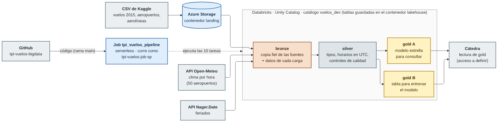

# TPI Vuelos · Pipeline Medallion en Azure Databricks

Trabajo práctico integrador de **Procesamiento de Big Data** (Licenciatura en Ciencia de Datos, Universidad Austral).

El pipeline integra los vuelos domésticos de EE.UU. de 2015 con el clima horario de los aeropuertos y los feriados
nacionales, y produce dos productos de datos:

- **Gold A:** un modelo estrella para analizar la puntualidad de los vuelos con joins simples.
- **Gold B:** una tabla para entrenar un modelo que predice si un vuelo va a llegar con 15 minutos o más de demora.

Todo corre en **Azure Databricks** con **Unity Catalog**, orquestado por un **Job de Lakeflow** que ejecuta el código
de este repositorio.

---

## Contenido

1. [Arquitectura](#arquitectura)
2. [Estructura del repositorio](#estructura-del-repositorio)
3. [Capas y tablas](#capas-y-tablas)
4. [Decisiones de diseño](#decisiones-de-diseño)
5. [Cómo desplegar](#cómo-desplegar)
6. [Cómo ejecutar](#cómo-ejecutar)
7. [Fuentes y atribución](#fuentes-y-atribución)
8. [Integrantes](#integrantes)

---

## Arquitectura



- **Fuentes:** el CSV de Kaggle se sube al contenedor `landing` de Azure Storage; el clima (Open-Meteo) y los feriados
  (Nager.Date) se piden a sus APIs.
- **Capas:** todas las tablas viven en el catálogo `vuelos_dev` de Unity Catalog, con un esquema por capa
  (`bronze`, `silver`, `gold`). Los archivos de las tablas se guardan en el contenedor `lakehouse`.
- **Ejecución:** el Job `tpi_vuelos_pipeline` baja el código de la rama `main` de este repositorio y corre con
  cómputo serverless, con la identidad del service principal `tpi-vuelos-job-sp`.

Los diagramas del Job y del modelo estrella están en [`docs/`](docs/README.md).

---

## Estructura del repositorio

```
tpi-vuelos-bigdata/
├── src/                  Lógica del pipeline, en módulos de Python importables
│   ├── common/           Lo que usan todas las capas: calidad, guardado, APIs, comentarios de UC
│   ├── bronze/           Ingesta de cada fuente
│   ├── silver/           Limpieza y estandarización de cada tabla
│   ├── gold/             Dimensiones, hechos, tabla de ML y diccionarios de datos
│   └── ml/               Modelo base (opcional)
├── notebooks/            Puntos de entrada delgados: los que ejecuta el Job
│   ├── bronze/           01a, 01b, 01c
│   ├── silver/           02a, 02b, 02c, 02d
│   ├── gold/             03a, 03b (Gold A) y 04a (Gold B)
│   └── ml/               05a (opcional, fuera del Job)
├── tests/                Pruebas automatizadas, con la misma estructura que src/
├── docs/                 Diagramas de arquitectura, del Job y del modelo estrella
└── requirements.txt      Dependencias
```

Los notebooks solo leen parámetros, llaman a funciones de `src/`, corren los controles de calidad y guardan.
Toda la lógica de transformación está en `src/` y se prueba sin correr el pipeline.

---

## Capas y tablas

| Capa | Tabla | Contenido | Carga |
|---|---|---|---|
| bronze | `flights_raw`, `airports_raw`, `airlines_raw`, `airport_codes_raw` | Los CSV tal como llegan, todo como texto, más `source_file`, `ingestion_ts` y `batch_id` | Full load (overwrite) |
| bronze | `weather_raw` | Un JSON de Open-Meteo por aeropuerto y rango de fechas | Incremental (MERGE por aeropuerto + rango) |
| bronze | `holidays_raw` | Un JSON de Nager.Date por año y país | Incremental (MERGE por año + país) |
| bronze | `ingestion_errors` | Lo que no se pudo ingerir y por qué | Append (historial) |
| silver | `flights` | Un vuelo por fila: tipos, horarios en UTC, códigos de aeropuerto traducidos, `flight_id` | Overwrite desde bronze |
| silver | `airports`, `airlines` | Con nombres claros; aeropuertos con zona horaria | Overwrite desde bronze |
| silver | `weather_hourly` | Una fila por aeropuerto y hora UTC | Overwrite desde bronze |
| silver | `holidays` | Un feriado por fila | Overwrite desde bronze |
| silver | `quality_checks` | Resultado de cada control de calidad, por corrida | Append (historial) |
| gold | `dim_date`, `dim_airline`, `dim_airport`, `dim_weather`, `fact_flights` | Modelo estrella (Gold A) | Overwrite desde silver |
| gold | `ml_flight_delay_training` | Tabla para entrenar el modelo (Gold B) | Overwrite desde silver |
| gold | `ml_population_log` | Cuántos vuelos entran a Gold B y cuántos se excluyen, y por qué | Overwrite |
| gold | `ml_data_dictionary` | Diccionario de datos de Gold B | Overwrite |

Todas las tablas de Gold tienen comentarios de tabla y de columna cargados en Unity Catalog.

---

## Decisiones de diseño

### Ingesta (Bronze)

- **Copia fiel:** los CSV se guardan con todas las columnas como texto. Convertir tipos es una decisión que se toma en Silver.
- **Full load para los CSV, MERGE para las APIs.** El CSV se lee entero o falla entero, así que reemplazar la tabla es seguro.
  Las APIs se piden por partes (un aeropuerto por llamada): con MERGE, si fallan algunos aeropuertos, conservan la carga
  anterior en vez de perderse, y el error queda registrado en `ingestion_errors`.
- **Clima solo para los 50 aeropuertos de origen con más vuelos**, como pide la consigna. El top 50 se calcula leyendo los CSV
  directo de `landing`, así que las tres ingestas son independientes entre sí.
- **Cuidado del límite de la API:** antes de llamar a Open-Meteo se estima el costo con la fórmula de la consigna y la tarea
  se frena si supera la mitad del límite diario. Cada llamada reintenta ante HTTP 429, errores del servidor o fallas de conexión,
  con esperas crecientes.

---

### Limpieza (Silver)

- **Horarios en UTC.** Los vuelos están en la hora oficial de cada aeropuerto, que cambia con el horario de verano, así que se
  convierten con `convert_timezone` y la zona horaria del aeropuerto. Open-Meteo usa un desfase fijo todo el año, así que al clima
  se le resta `utc_offset_seconds`. Usar el mismo método para los dos dejaría el clima de verano corrido una hora.
- **Zona horaria de cada aeropuerto** a partir de sus coordenadas (`timezonefinder`); los tres aeropuertos sin coordenadas se cargan a mano.
- **Códigos de octubre:** en octubre de 2015 los vuelos traen códigos numéricos de aeropuerto; se traducen a IATA con
  `master_coordinate.csv`, usando el código vigente en esa fecha.
- **Hora "2400"** se interpreta como las 00:00 del día siguiente.
- **Llegada calculada:** la llegada se calcula como salida en UTC + duración (+ demora para la real). Se descartan `SCHEDULED_ARRIVAL`
  y `ARRIVAL_TIME`, que vienen en hora local del destino y sin fecha (ambiguas cuando el vuelo cruza la medianoche), `DEPARTURE_TIME`
  (es la salida planeada + la demora) y `WHEELS_OFF` / `WHEELS_ON` (no se usan).
- **`flight_id`** es un hash (`xxhash64`) de fecha, aerolínea, número, origen, destino y hora planeada: da siempre el mismo valor para
  el mismo vuelo, en cualquier corrida. Se incluye el destino porque un mismo vuelo puede ir a dos destinos (caso real: AA 803 del 29/8/2015).

---

### Gold A: modelo estrella

- **Grano:** un vuelo programado, incluidos los cancelados y los desviados.
- **Claves:** naturales cuando existen (`AAAAMMDD` para fechas, código IATA para aerolíneas y aeropuertos); hash cuando la identidad
  combina columnas (`flight_id`, `weather_key` = aeropuerto + hora).
- **`dim_airport` cumple dos roles** (origen y destino).
- **Clima:** cada vuelo toma el clima de su aeropuerto de origen en la hora UTC de la salida programada. Los vuelos sin clima
  apuntan a la fila `-1` ("Sin dato") de `dim_weather`, para que un join común no los descarte.
- **Indicadores de demora** vacíos cuando no aplican (sin salida para los cancelados; sin llegada para cancelados y desviados).

---

### Gold B: tabla de machine learning

- **Población:** vuelos completados con clima en el origen. Cada exclusión (cancelado, desviado, sin clima, sin demora de llegada)
  queda contada en `ml_population_log`.
- **Target:** `is_delayed` = llegada con 15 minutos o más de demora.
- **Solo variables conocidas antes de salir:** calendario, feriados, clima en el origen e historia reciente.
- **Historia sin fuga de información:** cantidad de vuelos y tasa de demora por aerolínea, origen y ruta en los 30 días que terminan
  2 días antes del vuelo (el mismo día y el anterior no se miran).
- **Partición temporal:** train hasta `train_end`, validation hasta `validation_end`, test el resto.
- **Supuesto de pronóstico perfecto:** se usa el clima observado; en producción habría que usar un pronóstico, así que las métricas son optimistas.

---

### Calidad de datos

Cada notebook corre sus controles **antes de escribir** y los guarda en `silver.quality_checks` con el `batch_id` de la corrida.
Si falla un control crítico, la tarea se corta, la tabla anterior queda intacta y las tareas que dependen de ella no corren.
Ejemplos: misma cantidad de vuelos en Bronze, Silver y la tabla de hechos; `flight_id` sin repetir; ningún vuelo sin zona horaria;
cero claves huérfanas en el modelo estrella.

---

### Orquestación (Job de Lakeflow)

- **Dependencias por disponibilidad de datos** y paralelismo donde se puede (ver [`docs/arquitectura.md`](docs/arquitectura.md)).
- **Cómputo serverless:** se paga solo mientras corre cada tarea. Una corrida completa tarda unos 6 minutos y costó 1,17 USD.
- **Reintentos** (más en las tareas que llaman a APIs), **timeouts** por tarea y **notificación por mail** al grupo si falla.
- **Re-ejecución segura:** overwrite y MERGE no duplican datos, y el Job admite una sola corrida a la vez.
- **Repair run** probado con un fallo provocado (`force_fail = true` en `gold_dimensions`).
- **Tags** `proyecto = tpi-vuelos` y `entorno = dev` para atribuir el costo.
- **Trigger:** programado diario, en pausa, porque los datos de 2015 no cambian. En producción correría todos los días, ya que la
  historia de Gold B necesita cargas diarias.
- **Identidad:** el Job corre con el service principal `tpi-vuelos-job-sp` y no depende de la cuenta de ningún integrante.

---

## Cómo desplegar

**Requisitos en Azure**

1. Un resource group con una cuenta de Azure Storage (ADLS Gen2) con dos contenedores: `landing` y `lakehouse`.
2. Un workspace de Azure Databricks con Unity Catalog, con una external location para cada contenedor.
3. El catálogo y sus esquemas:
   ```sql
   CREATE CATALOG IF NOT EXISTS vuelos_dev;   -- con managed location en el contenedor lakehouse
   CREATE SCHEMA IF NOT EXISTS vuelos_dev.bronze;
   CREATE SCHEMA IF NOT EXISTS vuelos_dev.silver;
   CREATE SCHEMA IF NOT EXISTS vuelos_dev.gold;
   ```
4. Los archivos de entrada en `landing`:
   ```
   landing/kaggle/flight_delays_2015/flights.csv
   landing/kaggle/flight_delays_2015/airports.csv
   landing/kaggle/flight_delays_2015/airlines.csv
   landing/airport_codes/master_coordinate.csv
   ```

**En Databricks**

1. Conectar este repositorio como Git folder.
2. Crear el service principal y darle `ALL PRIVILEGES` y `MANAGE` sobre `vuelos_dev`, `READ FILES` sobre la external location de
   `landing` y una credencial de GitHub de solo lectura.
3. Crear el Job `tpi_vuelos_pipeline` con las 10 tareas de tipo notebook, fuente Git (rama `main`), cómputo serverless y los
   parámetros de la sección siguiente.

---

## Cómo ejecutar

### El pipeline completo

Desde el Job `tpi_vuelos_pipeline` → **Run now**. Para otro entorno o rango de fechas: **Run now with different parameters**.

| Parámetro | Valor | Uso |
|---|---|---|
| `catalog` | `vuelos_dev` | Catálogo de destino (el entorno) |
| `batch_id` | `{{job.run_id}}` | Identifica la corrida en las tablas y en los controles |
| `landing_path` | `abfss://landing@tpivuelos.dfs.core.windows.net` | Ubicación de los CSV |
| `start_date`, `end_date` | `2015-01-01`, `2015-12-31` | Rango del clima y de `dim_date` |
| `top_n` | `50` | Cantidad de aeropuertos con clima |
| `weather_variables` | `temperature_2m,precipitation,snowfall,wind_speed_10m,wind_gusts_10m,cloud_cover` | Variables pedidas a Open-Meteo |
| `year`, `country_code` | `2015`, `US` | Feriados a pedir |
| `train_end`, `validation_end` | `2015-08-31`, `2015-10-31` | Cortes de la partición temporal |
| `force_fail` | `false` | Solo para probar el repair run |

Cada notebook también puede correrse a mano: sus widgets tienen los mismos valores por defecto.

---

### Las pruebas (en una computadora, sin Databricks)

```powershell
python -m venv .venv
.venv\Scripts\Activate.ps1
pip install -r requirements.txt
pytest -v
```

Las pruebas usan un Spark local (`tests/conftest.py`) con DataFrames chicos armados a mano.

---

### Consultar gold desde afuera de Databricks

El script [`scripts/consulta_gold.py`](scripts/consulta_gold.py) se conecta al SQL warehouse con un access token y muestra
las primeras filas de cada tabla del modelo estrella y de la tabla de ML. El token no está en el repositorio: se entrega
por un canal privado y cada uno lo pega en su copia del script.

1. Instalar la librería:
   ```powershell
   pip install databricks-sql-connector
   ```
2. Abrir `scripts/consulta_gold.py` y reemplazar `PEGAR_ACA_EL_TOKEN` por el token.
3. Correr el script:
   ```powershell
   python scripts/consulta_gold.py
   ```

---

### El modelo (opcional)

El notebook `notebooks/ml/05a-ml_baseline.py` se corre una vez, a mano, después del Job. Entrena una línea base, una regresión
logística y un gradient boosting, y registra las métricas en MLflow.

---

## Fuentes y atribución

- **Vuelos:** *2015 Flight Delays and Cancellations*, Kaggle (datos del U.S. Department of Transportation).
- **Clima:** Zippenfenig, P. (2023). *Open-Meteo.com Weather API*. Datos de reanálisis ERA5 del Copernicus Climate Change Service.
  Plan gratuito, uso no comercial.
- **Feriados:** Nager.Date, API pública de feriados.

---

## Integrantes

- Bautista Torregiani
- Benjamín Miles
- Gregorio Fernández Perrier
- Justo Borras
