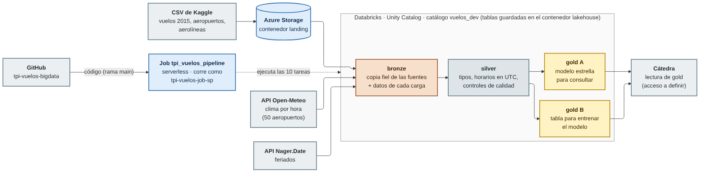
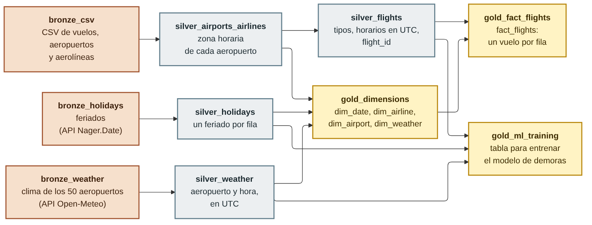
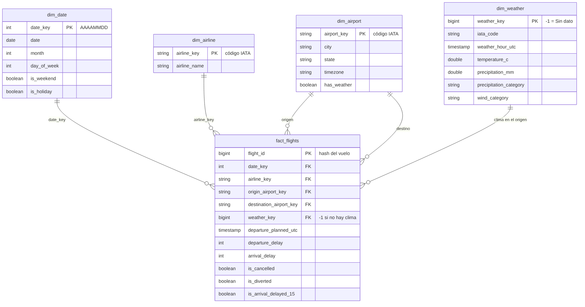

# Documentación del pipeline

Tres diagramas, de lo general a lo particular.

## 1. Arquitectura general

De dónde vienen los datos, por qué capas pasan y quién ejecuta y consume el pipeline.

- **Fuentes:** el CSV de Kaggle llega al contenedor `landing` de Azure Storage; el clima y los feriados se piden a sus APIs.
- **Capas:** todas las tablas viven en el catálogo `vuelos_dev` de Unity Catalog, con un esquema por capa, y sus archivos se guardan en el contenedor `lakehouse`.
- **Ejecución:** el Job baja el código de GitHub y corre con el service principal `tpi-vuelos-job-sp`.
- **Consumo:** la cátedra va a tener lectura sobre el esquema `gold`; el modo de acceso está pendiente de definir con la universidad.

## 2. Job de Lakeflow

Las 10 tareas, sus dependencias y qué corre en paralelo: ver [arquitectura.md](arquitectura.md).

## 3. Gold A: modelo estrella

Grano de `fact_flights`: una fila por vuelo programado, incluidos los cancelados y los desviados.
`dim_airport` cumple dos roles (origen y destino). Los vuelos sin clima apuntan a la fila `-1` ("Sin dato") de `dim_weather`.

