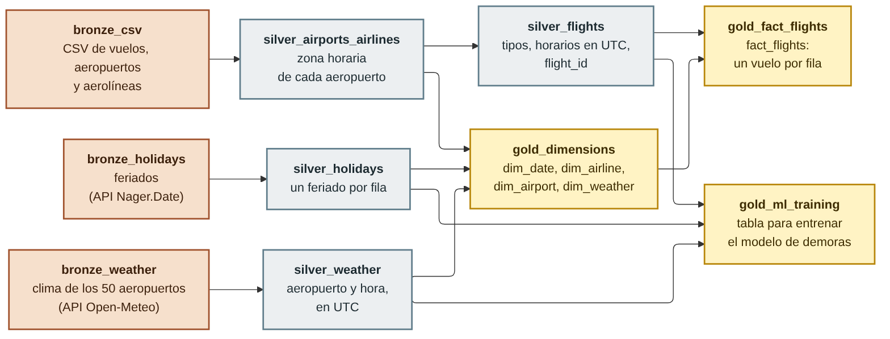
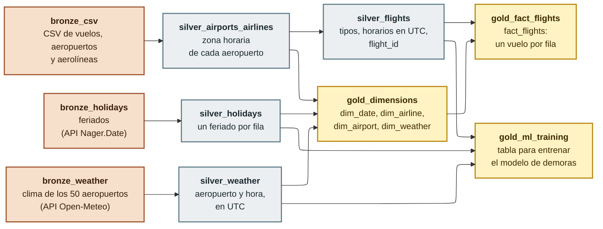

# Job de Lakeflow: `tpi_vuelos_pipeline`

El Job ejecuta el pipeline completo, de las fuentes a las dos tablas Gold, con 10 tareas de tipo notebook.
Cada tarea espera solo a las que producen los datos que necesita; las que no dependen entre sí corren en paralelo.
Colores: naranja = Bronze, gris = Silver, amarillo = Gold.

Código Mermaid del diagrama

## Por qué cada dependencia

| Tarea | Espera a | Porque necesita |
|---|---|---|
| `bronze_csv`, `bronze_holidays`, `bronze_weather` | nada | Cada ingesta depende solo de su fuente. `bronze_weather` calcula los 50 aeropuertos con más vuelos leyendo los CSV directo del contenedor `landing`. |
| `silver_airports_airlines` | `bronze_csv` | Los aeropuertos y las aerolíneas crudos. |
| `silver_holidays` | `bronze_holidays` | Los feriados crudos. |
| `silver_weather` | `bronze_weather` | El clima crudo (JSON por aeropuerto). |
| `silver_flights` | `silver_airports_airlines` | La zona horaria de cada aeropuerto, para pasar los horarios a UTC. Los vuelos crudos ya están cargados, porque `silver_airports_airlines` espera a `bronze_csv`. |
| `gold_dimensions` | `silver_airports_airlines`, `silver_holidays`, `silver_weather` | Aeropuertos y aerolíneas, feriados (para `dim_date`) y clima (para `dim_weather`). |
| `gold_fact_flights` | `gold_dimensions`, `silver_flights` | Los vuelos y las dimensiones ya creadas, para controlar que no queden claves huérfanas. |
| `gold_ml_training` | `silver_flights`, `silver_holidays`, `silver_weather` | Vuelos, feriados y clima. No depende de Gold A, así que corre en paralelo con el modelo estrella. |

## Niveles de dependencia

Cada nivel agrupa las tareas que solo esperan a las de niveles anteriores. No son horarios exactos: cada tarea arranca apenas terminan las suyas.

| Nivel | Tareas |
|---|---|
| 1 | `bronze_csv`, `bronze_holidays`, `bronze_weather` |
| 2 | `silver_airports_airlines`, `silver_holidays`, `silver_weather`  |
| 3 | `silver_flights`, `gold_dimensions` |
| 4 | `gold_fact_flights`, `gold_ml_training` |

## Configuración

- **Código:** desde el repositorio de GitHub, rama `main`.
- **Cómputo:** serverless.
- **Identidad:** corre como el service principal `tpi-vuelos-job-sp`.
- **Parámetros:** `catalog`, `start_date`, `end_date`, `landing_path`, `top_n`, `weather_variables`, `year`, `country_code`, `train_end`, `validation_end`, `batch_id = {{job.run_id}}` y `force_fail` (solo para probar el repair run).
- **Si un control de calidad crítico falla,** la tarea se corta antes de escribir y las tareas que dependen de ella no corren.
